# CargoVerse database (Oracle)

CargoVerse stores everything in an Oracle database: people and their access rights,
the fleet, shipments, inventory, the work assigned to staff, and a permanent history
of every change. The scripts live in `db/oracle/` and work on Oracle Database 19c, 21c
and 23ai (including the free editions).

| Script | What it does |
| --- | --- |
| `00_create_user.sql` | Optional: creates the `WARETRACK` schema owner (run as `SYSTEM`) |
| `01_schema.sql` | 44 tables with primary/foreign keys, check constraints, identity columns, virtual columns, function-based unique indexes and comments |
| `02_plsql.sql` | Packages `WT_CORE`, `WT_AUTH`, `WT_WORK`, `WT_PARK`, `WT_PORT`, `WT_RETAIL` and 14 triggers |
| `03_views.sql` | 17 views used by the KPIs, reports, the park directory, the import/export log, the port and the stores |
| `04_seed.sql` | Seed data (generated from the app's data by `npm run db:gen-seed`) |
| `05_reports.sql` | 25 sample queries: joins, ROLLUP, HAVING, window functions, PIVOT, anti-joins, MINUS, date arithmetic and the PL/SQL API. They also appear in the app's SQL console |
| `06_lab.sql` | Database Lab: the `DB_COMMANDS` queue and its `TRG_EXT_*` triggers, `DOCK_BOOKINGS`, `LAB_STOCK` and package `WT_LAB` |
| `07_security_sys.sql` | Run as `SYS` (done automatically): `EXECUTE` on `DBMS_RLS` and the demo accounts `CV_ADMIN`, `CV_ALEX`, `CV_MEERA`, `CV_ZOE` |
| `08_security.sql` | `DB_ACCOUNTS`, package `WT_SECURITY` and the `CV_SITE_ROWS` VPD policy on 15 tables |
| `09_security_sys.sql` | Run as `SYS`: synonyms so the demo accounts can write `trucks` instead of `waretrack.trucks` |
| `10_wms.sql` | Smart Warehouse: bins, aisle graph, lots, bin contents, the lot ledger, sensors, breaches, scans, damage reports, events; packages `WT_WMS` and `WT_EVENTS`; 9 views |
| `11_wms_seed.sql` | Generated: racks and bins of each building, the aisle graph, product handling rules, sensors, 90 days of demand, damage reports |
| `12_wms_optional.sql` | Oracle 21c/23ai upgrades, each skipped if unavailable: interval partitioning, blockchain table, VECTOR columns, Transactional Event Queue, scheduler jobs, property graph |
| `99_drop_all.sql` | Removes every CargoVerse object |

## Entity–relationship diagram

```mermaid
erDiagram
    ROLES ||--o{ ROLE_PERMISSIONS : grants
    PERMISSIONS ||--o{ ROLE_PERMISSIONS : "granted by"
    ROLES ||--o{ APP_USERS : "role of"
    JOB_TITLES ||--o{ EMPLOYEES : "job of"
    FACILITIES ||--o{ EMPLOYEES : "home site of"
    EMPLOYEES ||--o| APP_USERS : "signs in as"
    APP_USERS ||--o{ USER_FACILITY_ACCESS : "may access"
    FACILITIES ||--o{ USER_FACILITY_ACCESS : "accessible by"
    APP_USERS ||--o{ USER_SESSIONS : "has"

    FACILITIES ||--o{ DOCKS : has
    FACILITIES ||--o{ CHARGERS : has
    FACILITIES ||--o{ INVENTORY : stocks
    SKUS ||--o{ INVENTORY : "stocked as"
    FACILITIES ||--o{ STOCK_MOVEMENTS : "ledger of"
    SKUS ||--o{ STOCK_MOVEMENTS : moves

    CARRIERS ||--o{ DRIVERS : employs
    CARRIERS ||--o{ TRUCKS : operates
    DRIVERS ||--o{ TRUCKS : drives
    FACILITIES ||--o{ TRUCKS : serves
    DOCKS |o--o| TRUCKS : "occupied by"
    TRUCKS ||--o{ SHIPMENTS : carries
    SKUS ||--o{ SHIPMENTS : contains

    FACILITIES ||--o{ FORKLIFTS : has
    EMPLOYEES |o--o{ FORKLIFTS : operates
    CHARGERS ||--|| FORKLIFTS : charges
    FORKLIFTS |o--o| PALLETS : carries
    FACILITIES ||--o{ PALLETS : holds
    SKUS ||--o{ PALLETS : "packed on"

    FACILITIES ||--o{ TASKS : "work at"
    EMPLOYEES |o--o{ TASKS : "assigned to"
    APP_USERS |o--o{ TASKS : "created by"
    TASKS ||--o{ TASK_UPDATES : "history of"
    TRUCKS |o--o{ TASKS : about
    DOCKS |o--o{ TASKS : at

    FACILITIES ||--o{ OPERATION_EVENTS : "events at"
    APP_USERS |o--o{ AUDIT_LOG : "changes by"

    PARK_COMPANIES ||--o{ PARK_BUILDINGS : "leases"
    FACILITIES |o--o| PARK_BUILDINGS : "housed in"
    PARK_COMPANIES |o--o{ PARK_VEHICLES : owns
    PARK_ROUTES ||--o{ PARK_VEHICLES : "driven by"
    PARK_BUILDINGS ||--o| PARK_GATES : "gatehouse of"
    PARK_GATES ||--o{ PARK_GATE_LOG : records
    TRUCKS ||--o{ PARK_GATE_LOG : "passes"
    FACILITIES ||--o{ PARK_GATE_LOG : "imports/exports of"
    SKUS |o--o{ PARK_GATE_LOG : carries
    SHIPMENTS |o--o{ PARK_GATE_LOG : "moved by"

    SHIPPING_LINES ||--o{ VESSELS : operates
    PARK_BUILDINGS ||--o{ PORT_BERTHS : "quay of"
    PORT_BERTHS |o--o| VESSELS : "alongside"
    PORT_BERTHS ||--o{ QUAY_CRANES : "worked by"
    VESSELS ||--o{ VESSEL_CALLS : "calls"
    SHIPPING_LINES ||--o{ CONTAINER_MOVES : "boxes of"
    VESSELS |o--o{ CONTAINER_MOVES : "discharged / loaded"
    QUAY_CRANES |o--o{ CONTAINER_MOVES : lifts
    TRUCKS |o--o{ CONTAINER_MOVES : "collects / delivers"
    YARD_BLOCKS ||--o{ YARD_CONTAINERS : stacks

    PARK_BUILDINGS ||--o| STORES : houses
    FACILITIES ||--o{ STORES : "usually supplies"
    STORES ||--o{ STORE_STOCK : shelves
    SKUS ||--o{ STORE_STOCK : "sold as"
    STORE_STOCK ||--o{ STORE_ORDERS : "restocked by"
    FACILITIES ||--o{ STORE_ORDERS : "ships"
    DELIVERY_VANS |o--o{ STORE_ORDERS : delivers
    FACILITIES ||--o{ DELIVERY_VANS : "depot of"
    STORE_ORDERS ||--o{ STORE_ORDER_HISTORY : "history of"
```



## The logistics park, imports and exports

The three CargoVerse sites sit in the **Harborside Logistics Park** with ten other companies:
a car-parts plant, a bottling plant, a solar-panel factory, a cold store, a medical-supplies
warehouse, a grocery warehouse, an office tower, a fuel station, the park authority and the
Port Newark container terminal. All of these are rows in the database:

| Table | Holds |
| --- | --- |
| `PARK_COMPANIES` | Tenants, their industry, contact and brand colour. At most one company is the logistics operator (function-based unique index `UX_COMPANY_OPERATOR`) |
| `PARK_BUILDINGS` | Every building on the map: position, size, floors, staff, status and lease. `FLOOR_AREA_M2` is a virtual column. Rows with `FACILITY_ID` are CargoVerse's own sites |
| `PARK_ROUTES`, `PARK_VEHICLES` | The roads' traffic: cars, vans, a shuttle bus, tenants' trucks and public traffic, each on a route at a speed |
| `PARK_GATES` | The West Gate (imports in) and East Gate (exports out) |
| `PARK_GATE_LOG` | **Every CargoVerse truck through a gate**: direction, `IMPORT` / `EXPORT` / `EMPTY`, product and pallets |

Rules in the database:
- `CK_GL_GATE_DIR`: trucks only enter at the West Gate and leave at the East Gate.
- `CK_GL_CARGO`: an import must come in loaded, an export must leave loaded, and an empty
  move carries 0 pallets.
- `TRG_GATE_LOG_AI` keeps `FACILITIES.IMPORTS_TODAY / EXPORTS_TODAY` (and the pallet counts) in
  step with the log, the same way the stock ledger keeps stock totals.
- `WT_PARK.UPDATE_BUILDING` needs `MANAGE_PARK` and refuses to mark a running CargoVerse
  site as vacant or under construction. Leases cannot end before they start.
  `TRG_PARK_BUILDINGS_AUDIT` writes every change to the audit log.
- `V_TRADE_TODAY` (imports vs exports per site), `V_GATE_LOG` and `V_PARK_DIRECTORY` feed the
  dashboards.

## The container port

Ships call at the Port Newark terminal on the bay; four quay cranes work the two berths.

| Table | Holds |
| --- | --- |
| `SHIPPING_LINES` | Lines whose boxes pass through, with the ISO 6346 owner code (`CK_LINE_OWNER`: line code + `U`) |
| `PORT_BERTHS` | The two berths, open or closed, and the ship alongside |
| `VESSELS` | Each ship: line, IMO number, status (`AT_SEA` → `ARRIVING` → `ANCHORED` → `BERTHING` → `BERTHED` → `DEPARTING`), boxes to discharge and loaded, hold flag, position |
| `QUAY_CRANES` | Crane per berth, what it is doing and its moves today |
| `VESSEL_CALLS` | One row per port call: berthed, sailed, boxes off and on. `CALL_STATUS` is a virtual column |
| `CONTAINER_MOVES` | **The container ledger**: every lift off a ship (`DISCHARGE`), onto a ship (`LOAD`), and every box through the terminal gate (`GATE_OUT` by truck to a warehouse, `GATE_IN` for export). `LINE_CODE` is a virtual column with a foreign key to `SHIPPING_LINES` |
| `YARD_BLOCKS`, `YARD_CONTAINERS` | The import and export stacks and the boxes in them now |

Rules in the database:
- `TRG_CONTAINER_MOVES_BI` rejects any container number whose ISO 6346 check digit is wrong
  (`WT_PORT.CHECK_DIGIT` computes it in PL/SQL).
- `TRG_CONTAINER_MOVES_AI` keeps `YARD_CONTAINERS` in step with the ledger: discharged and gated-in
  boxes are stacked, loaded and gated-out boxes leave the stack.
- `CK_MOVE_SHIP`: ship moves need a ship and a crane; gate moves have neither.
- `WT_PORT.LOG_CALL` opens and closes `VESSEL_CALLS`; `WT_PORT.SET_VESSEL_HOLD` and
  `WT_PORT.SET_BERTH_OPEN` need `MANAGE_PORT`, keep at least one berth open and write the audit log.
- `SHIPMENTS.TRADE_LANE` / `CONTAINER_NO` (and `TRUCKS.TRADE_LANE`) mark sea freight: an import
  collected at the terminal or an export taken there, with `CK_SHIP_CONTAINER` requiring a valid
  container number for `SEA` and none for `ROAD`.
- Views: `V_VESSEL_SCHEDULE`, `V_PORT_BERTHS`, `V_YARD_SUMMARY`, `V_CONTAINER_MOVES`.

## Vendor stores and deliveries

| Table | Holds |
| --- | --- |
| `STORES` | Supermarkets and shops in Port Harbor, the building they occupy and their usual supplying warehouse |
| `STORE_STOCK` | Shelf stock per store and product, reorder point, maximum, sales rate. `STOCK_STATUS` is a virtual column (`OK` / `REORDER` / `EMPTY`) |
| `STORE_ORDERS` | Restock orders on the warehouses: `PLACED` → `LOADING` → `OUT_FOR_DELIVERY` → `DELIVERED` (or `CANCELLED`), automatic or placed by a manager |
| `STORE_ORDER_HISTORY` | Every status change of every order (written by `TRG_STORE_ORDERS_AIU`) |
| `DELIVERY_VANS` | CargoVerse vans and box trucks, their depot, status and current order |

Rules in the database:
- `FK_SO_LINE` is a composite foreign key `(STORE_ID, SKU_ID)` onto `STORE_STOCK`: a store can only
  order products it sells.
- `CK_SO_VAN`: an order being loaded or delivered must have a van; `CK_VAN_ORDER`: a van is idle
  exactly when it has no order.
- Loading a van takes the units off the warehouse through the stock ledger
  (`STOCK_MOVEMENTS.REASON = 'STORE_SHIP'`), so `TRG_STOCK_MOVEMENTS_AI` updates `INVENTORY`.
- `TRG_STORE_ORDERS_BIU` stamps dispatch and delivery times.
- `WT_RETAIL.PLACE_ORDER` / `CANCEL_ORDER` need `MANAGE_RETAIL`, refuse a second open order for
  the same shelf line, check the warehouse has the units, and write the audit log.
  `WT_RETAIL.BEST_SUPPLIER` and `WT_RETAIL.COVER_HOURS` are helper functions.
- Views: `V_STORE_STOCK`, `V_STORE_ORDERS`, `V_DELIVERY_FLEET`. Reports 19–26 in `05_reports.sql`
  cover port throughput, turnaround, container tracing, yard occupancy, store stock and deliveries.

## Database workspace in the app

Administrators and managers have a **Database** tab in the Work panel:
- **Tables**: every table with its row count, columns, keys, constraints, indexes and first rows,
  read live from Oracle's data dictionary (`USER_TABLES`, `USER_TAB_COLS`,
  `USER_CONSTRAINTS`…). It also shows the compile status of every view, trigger and package.
- **SQL console** (administrators only): runs one `SELECT` / `WITH` statement inside
  `SET TRANSACTION READ ONLY`, so Oracle itself rejects any change. The console caps results at 500
  rows and cancels a query after 15 s. Every query is recorded in the audit log, and
  the examples from `05_reports.sql` are one click away.
- **SQL activity**: the statements the server has sent to Oracle, with timings, including
  the live-operations writes every 2 seconds.

## Database Lab

Four features that exist only because the city lives in a database. `npm run db:setup` installs
them; `npm run db:lab` adds them to an existing schema without touching the data, and
`npm run db:selftest` checks all four against Oracle.

### 1. Control the city from SQL

Seven tables can be changed from outside the application:

| Table | Column(s) | In the city |
| --- | --- | --- |
| `PORT_BERTHS` | `is_open` | The berth closes; the next ship waits at anchor (at least one berth must stay open — `TRG_PORT_BERTHS_ONE_OPEN`, `ORA-20004`) |
| `VESSELS` | `on_hold` | The ship stops wherever it is |
| `STORE_STOCK` | `units` | The shelf empties; the store reorders and a van brings stock |
| `FORKLIFTS` | `battery_pct` | The forklift finishes its move and goes to charge; an alert appears |
| `SIM_STATE` | `paused`, `speed` | The whole city pauses or speeds up |
| `PARK_BUILDINGS` | `bldg_status` | The building shows maintenance cones or closes |
| `TASKS` | insert, `task_status`, `assigned_to`, `priority` | The task appears or changes in everyone's Work panel |

How it works: the CargoVerse server tags each of its sessions with
`MODULE = 'cargoverse-api'`. An `AFTER UPDATE … FOR EACH ROW` trigger on each table calls
`WT_LAB.IS_EXTERNAL`; for any other session (SQL Developer, SQL*Plus, a script) it writes the change
to `DB_COMMANDS` with the old and new value, the database user, program, host and OS user. The server
reads the `PENDING` rows every second, applies them to the live city, marks them `APPLIED` or
`REJECTED`, and shows them as notifications with the camera flying to the place that changed.

The server writes the live city back every 2 seconds. To never overwrite a row an outside session
is still changing, it first runs `SELECT … FOR UPDATE SKIP LOCKED` and leaves locked rows for the
next round.

```sql
-- in SQL Developer, signed in as waretrack
UPDATE port_berths SET is_open = 'N' WHERE berth_code = 'B1';
COMMIT;   -- nothing happens until you commit: other sessions cannot see uncommitted changes
SELECT cmd_id, table_name, row_key, old_value, new_value, cmd_status, client_program FROM db_commands ORDER BY cmd_id DESC;
```

### 2. Time machine (Flashback)

Oracle keeps the previous versions of changed rows in its undo data. The time machine converts a
moment to an SCN (`TIMESTAMP_TO_SCN`) and reads 12 tables `AS OF SCN` at that one SCN, so the
picture is consistent across tables. Row history uses **Flashback Versions Query**:

```sql
SELECT versions_starttime, versions_endtime, versions_operation, vessel_status, berth_code, discharged
  FROM vessels VERSIONS BETWEEN TIMESTAMP SYSTIMESTAMP - INTERVAL '5' MINUTE AND SYSTIMESTAMP
 WHERE vessel_id = 'VSL-01'
 ORDER BY versions_startscn DESC NULLS FIRST;
```

How far back depends on `UNDO_RETENTION` (default 900 s); the app allows up to `FLASHBACK_MAX_S`
(600 s). If the undo is gone (`ORA-01555`, `ORA-08180`) or the table was just recreated
(`ORA-01466`), the server uses its own in-memory snapshots and says so.

### 3. Row-level security (Virtual Private Database)

Each demo database account is mapped in `DB_ACCOUNTS` to a CargoVerse user. The policy
`CV_SITE_ROWS` on 15 tables with a `FACILITY_ID` calls `WT_SECURITY.SITE_FILTER`, which returns:

* `NULL` (no filter) for the schema owner and for users with `VIEW_ALL_FACILITIES`;
* `facility_id IN ('WH-04')` built from `USER_FACILITY_ACCESS` for everyone else;
* `1 = 0` for unknown or deactivated accounts.

The policy covers `SELECT, INSERT, UPDATE, DELETE` with `update_check`, so rows outside the user's
sites can be neither read nor written. The demo accounts have `SELECT` on every table except
`APP_USERS`, `USER_SESSIONS` and `DB_ACCOUNTS`. Changing a user's site access in the app changes what
their database account sees, immediately.

| Account | CargoVerse user | Sees |
| --- | --- | --- |
| `CV_ADMIN` | admin | every site |
| `CV_ALEX` | alex.chen | WH-01, WH-04 |
| `CV_MEERA` | meera.iyer | WH-02 |
| `CV_ZOE` | zoe.reyes | WH-04 |

Password `Cargo_2026` (`LAB_DB_PASSWORD` in `.env`).

### 4. Concurrency lab

Each experiment opens two sessions and runs them against each other on sandbox tables:

| Experiment | Result | Mechanism |
| --- | --- | --- |
| Double booking | Protected — one booking, the second session waits and is refused | `WT_LAB.BOOK_DOCK` locks the dock row with `SELECT … FOR UPDATE WAIT 15`; unique key `UQ_DOCK_SLOT` as a final guard |
| Lost update | Anomaly — one sale disappears | Both sessions read, then write `units = :value` |
| The fix | Protected — both sales counted | `SELECT … FOR UPDATE` makes the second session wait for the first |
| Deadlock | Detected — `ORA-00060` | A locks LAB-A, B locks LAB-B, each then needs the other; Oracle rolls back one statement |

## Smart Warehouse

Inventory by **lot** and **bin** on top of the core schema. Each building has racks (aisles A, B, …; bays;
left/right; three levels) in `STORAGE_BINS`, joined by an aisle network `WH_NODES` / `WH_EDGES` (a graph); each
bin knows its walking distance to the nearest dock door. `LOTS` hold one product received together (one lot per
inbound shipment), with an expiry date and a quality status; `BIN_STOCK` says which pallet (GS1 SSCC) of which lot
is in each bin. Every change is a row in `LOT_MOVES`; its trigger updates the lot balance, the day's demand in
`SKU_DAILY_DEMAND` and copies the row into `STOCK_LEDGER`.

```
VESSELS ─▶ CONTAINER_MOVES ─▶ SHIPMENTS (in) ─▶ LOTS ─▶ LOT_MOVES ─▶ SHIPMENTS (out) / STORE_ORDERS ─▶ STORES
                                                  │         │
                                     BIN_STOCK ◀──┘         └─▶ STOCK_LEDGER (blockchain) · SKU_DAILY_DEMAND
                                        │
                                  STORAGE_BINS ─▶ WH_NODES ◀─ WH_EDGES        SENSORS ─▶ SENSOR_READINGS ─▶ COLD_BREACHES
```

| Feature | Objects | SQL / PL/SQL technique |
| --- | --- | --- |
| ABC slotting | `V_SKU_ABC`, `V_BIN_CONTENTS`, `WMS_SETTINGS` | `RATIO_TO_REPORT`, running `SUM() OVER (ORDER BY … ROWS UNBOUNDED PRECEDING)`, `ROW_NUMBER` |
| FEFO picking and audit | `WT_WMS.FEFO_LOT`, `V_LOT_STOCK`, `V_FEFO_VIOLATIONS` | `RANK() OVER (PARTITION BY … ORDER BY expiry_date)`; violations re-compute each lot's balance from the ledger at the moment of the pick |
| Recall trace | `V_TRACE_LINKS`, `WT_WMS.RECALL_LOT` | Recursive `WITH` with `SEARCH DEPTH FIRST` and `CYCLE`; the recall quarantines, creates tasks per store, audits and publishes an event in one transaction |
| Cold chain | `SENSOR_READINGS` (interval-partitioned by day), `COLD_BREACHES`, `WT_WMS.DETECT_BREACHES`, job `CV_DETECT_BREACHES` | `MATCH_RECOGNIZE … PATTERN (out_of_range{3,})`; holds only lots whose product range the temperature left; old days dropped with `ALTER TABLE … DROP PARTITION` |
| Tamper-proof ledger | `STOCK_LEDGER` | `CREATE BLOCKCHAIN TABLE … NO DELETE UNTIL 16 DAYS AFTER INSERT HASHING USING "SHA2_512"`; `DBMS_BLOCKCHAIN_TABLE.VERIFY_ROWS` |
| Forecast and reorder | `V_DEMAND_FORECAST`, `V_REPLENISHMENT` | `MODEL … RULES (trend[ANY] = intercept[CV()] + slope[CV()] * CV(day_no))`, `REGR_SLOPE`, `STDDEV`; reorder point and EOQ |
| GS1 scanning | `BIN_STOCK.ck_bs_sscc`, `WT_WMS.SCAN`, `SCAN_LOG` | The mod-10 check digit of an 18-digit SSCC written as a `CHECK` constraint |
| Event stream | `WT_EVENTS`, `WMS_EVENTS`, queue `CV_EVENTS` | `DBMS_AQ.ENQUEUE` inside the caller's transaction (delivered only on commit); the server dequeues with `DBMS_AQ.DEQUEUE` |
| Pick route | `WT_WMS.SHORTEST_PATH`, `CV_WAREHOUSE_GRAPH` | Dijkstra in PL/SQL with associative arrays; `GRAPH_TABLE (… MATCH (d)-[e IS aisle]-{1,6}(n))` |
| Semantic search | `DAMAGE_REPORTS.EMBEDDING`, `SKU_HANDLING.EMBEDDING` | `VECTOR(384, FLOAT32)`, `VECTOR_DISTANCE(…, COSINE)` |

Try it in SQL Developer:

```sql
SELECT * FROM v_sku_abc ORDER BY facility_id, velocity_rank;          -- ABC classes
SELECT wt_wms.fefo_lot('WH-04', 'MED-INS') FROM dual;                 -- the lot to pick next
UPDATE sensors SET door_open = 'Y' WHERE sensor_id = 'TS-04-C1'; COMMIT;   -- watch the breach in the app
UPDATE stock_ledger SET units = 0;                                    -- ORA-05715: refused
SELECT wt_wms.shortest_path('WH-04-I1', 'WH-04-O10') FROM dual;       -- Dijkstra in PL/SQL
```

## Design notes

**Normalization.** The schema is in third normal form. Lookups are separate tables:
roles, permissions, job titles, carriers, drivers and SKUs. Many-to-many relationships
use junction tables (`ROLE_PERMISSIONS`, `USER_FACILITY_ACCESS`). Facts depend only on
their key: a truck row holds the truck's own data, and the carrier name lives in
`CARRIERS`.

**Controlled denormalization.** `FACILITIES.STOCK_PALLETS` and `INVENTORY.UNITS` are
running totals. They are never written directly. Every change is a row in
`STOCK_MOVEMENTS`, and the trigger `TRG_STOCK_MOVEMENTS_AI` keeps the totals in step,
so stock is always traceable to its movements. Report 5 rebuilds the running total from
the ledger with a window function.

**People vs. accounts.** `EMPLOYEES` holds who someone is and their job (Forklift
Operator, Dock Supervisor…). `APP_USERS` holds how they sign in and their access role
(Administrator, Manager, Operator). An employee can exist without a login, for example
a driver. Access rights come from the role (`ROLE_PERMISSIONS`) plus the sites granted
in `USER_FACILITY_ACCESS`.

**Integrity rules enforced by the database:**
- Check constraints: valid statuses and priorities; cargo between 0 and capacity;
  battery 0–100 %; stock ≥ 0; lower-case usernames; scrypt-format password hashes;
  JSON columns validated with `IS JSON`.
- `CK_TASK_ASSIGNED`: a task that is assigned, in progress, blocked or done must have
  an assignee.
- `UX_PALLET_SLOT`: a function-based unique index, so a yard slot holds one pallet at a time.
- `CK_PAL_PLACE`: a pallet is either in a yard slot or on a forklift, never both. The
  virtual column `PALLET_STATUS` derives STAGED / IN_TRANSIT from that.
- Circular references (truck ↔ dock, forklift ↔ pallet, truck ↔ current shipment) use
  `DEFERRABLE INITIALLY DEFERRED` foreign keys, so a whole state change commits atomically.

**Business rules in PL/SQL.** The API calls these procedures instead of updating
tables directly, so the same rules apply no matter which client changes the data:

| Procedure | Rule it enforces |
| --- | --- |
| `WT_WORK.CREATE_TASK` | Caller needs `MANAGE_TASKS` and access to the site; the assignee must be an active employee of that site |
| `WT_WORK.CHANGE_STATUS` | Allowed transitions only (e.g. ASSIGNED → IN_PROGRESS → DONE). Operators may only move their own tasks, and only Start / Block / Resume / Complete |
| `WT_WORK.ASSIGN` | Managers re-assign within their sites; closed tasks cannot be re-assigned |
| `WT_AUTH.CREATE_USER` / `UPDATE_USER` | Needs `MANAGE_USERS`; admins cannot deactivate or demote themselves; deactivating revokes the user's sessions |
| `WT_AUTH.RECORD_LOGIN` / `CREATE_SESSION` / `REVOKE_SESSION` | Sign-in history, failed attempts and sessions |

Errors come back as `ORA-20001…20006`, and the API turns them into clear messages.

**Audit trail.** At the start of each transaction the API runs
`DBMS_SESSION.SET_IDENTIFIER(user_id)`. The audit triggers on `TASKS`, `APP_USERS`,
`USER_FACILITY_ACCESS`, `EMPLOYEES` and `SIM_STATE` read it through
`SYS_CONTEXT('USERENV','CLIENT_IDENTIFIER')`. Every human change is therefore written
to `AUDIT_LOG` together with who made it, inside the same transaction. Password hashes
are never written to the log. Administrators see the full log. Managers see entries for
their own sites (`V_AUDIT_FEED`).

**Operations data.** The server runs the live yard: trucks, docks, forklifts and pallets.
Every 2 seconds it writes changes in one transaction:
- `MERGE` for shipments and pallets;
- `UPDATE` for trucks, forklifts, docks and chargers;
- `INSERT` into the `STOCK_MOVEMENTS` and `OPERATION_EVENTS` ledgers.

Trucks passing a park gate add a row to `PARK_GATE_LOG` in the same transaction.
On restart it rebuilds the yard from these tables. When a forklift starts on a truck,
the server calls `WT_WORK.CREATE_TASK` to give that forklift's operator an
Unload or Load task. When the truck is finished, the task is completed.

## Roles and rights

| Permission | Administrator | Manager | Operator |
| --- | :-: | :-: | :-: |
| View live dashboard | ✓ | ✓ | ✓ |
| Access every site | ✓ | assigned sites | home site |
| Create / assign / cancel tasks | ✓ | ✓ | – |
| Start / block / complete own tasks | ✓ | ✓ | ✓ |
| See audit history | all sites | own sites | – |
| Team & workload, SQL reports | ✓ | ✓ | – |
| Pause / resume / speed up operations | ✓ | ✓ | – |
| Create users, change roles and site access, reset passwords | ✓ | – | – |
| Imports / exports and the park directory | all sites | own sites | own site |
| Edit park tenants (status, staff, lease) | ✓ | – | – |
| Browse the database schema (Database tab) | ✓ | ✓ | – |
| Run SQL in the read-only console, see SQL activity | ✓ | – | – |

**Sign-in.** Passwords are stored as scrypt hashes. "Keep me signed in" sessions last
30 days and are renewed each time they're used, so an active user stays signed in
indefinitely. Signing out, or an admin deactivating the account, ends the session
straight away.

## Connecting with SQL Developer

* Host `localhost`, port `1521`, service name `FREEPDB1`
* User `waretrack`, password `WareTrack_2026` (or what you set in `docker-compose.yml` / `.env`)

The project was once called WareTrack. The database user, its password, the Docker container
(`waretrack-oracle`) and volume keep that original name so existing databases and connections
keep working; so do internal keys such as the company id `WARETRACK` and carrier `WareTrack`.

Then open `db/oracle/05_reports.sql` and run the queries.

For the Database Lab, also make connections for `cv_zoe`, `cv_alex`, `cv_meera` and `cv_admin`
(password `Cargo_2026`, same host, port and service) — see [DEMO.md](DEMO.md).
